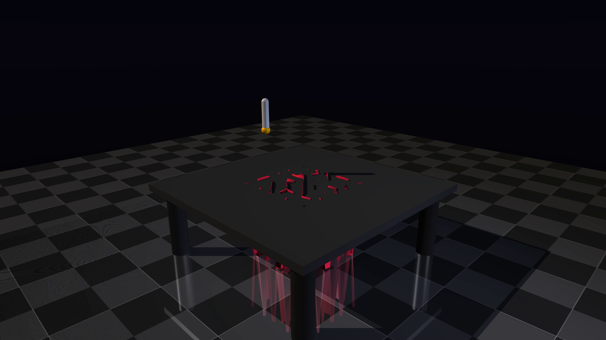

# Zero-Shot Garment Manipulation via VLA Models

An autonomous development project simulating a dual-arm setup folding cloth using MuJoCo's soft-body physics. The system utilizes a 4-bit quantized Vision-Language-Action (VLA) model (e.g., PaliGemma) to output spatial target coordinates based on text commands, specifically targeting complex deformable object manipulation.

## Environment & Cinematic Renderer

The physics environment features a Hollywood-level studio set built natively in MuJoCo XML (`scene.xml`), utilizing:
- **3-Point Lighting:** Key, fill, and rim lights for dramatic, high-contrast shadows.
- **Cinematic Tracking:** A dynamic target camera following the manipulator's interactions.
- **Soft-Body Physics:** Using MuJoCo's `<flexcomp>` for highly realistic cloth/garment dynamics.

### Rendered Example

*A full 1080p 60FPS cinematic render is generated via `test_camera_stream.py` and saved as `cinematic_render.mp4` in this repository.*

## Architecture (In Progress)
1. **Environment Physics:** `scene.xml` - Deformable garment and manipulator.
2. **Headless Renderer:** `test_camera_stream.py` - High-quality offline video generation.
3. **VLM Perception Node:** (WIP) - 4-bit quantized PaliGemma integration for spatial grounding.
4. **Kinematic Execution:** (WIP) - 2D pixel to 3D Cartesian mapping for actuator control.
